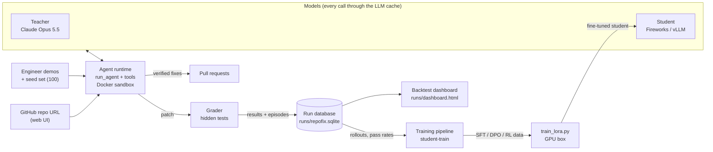
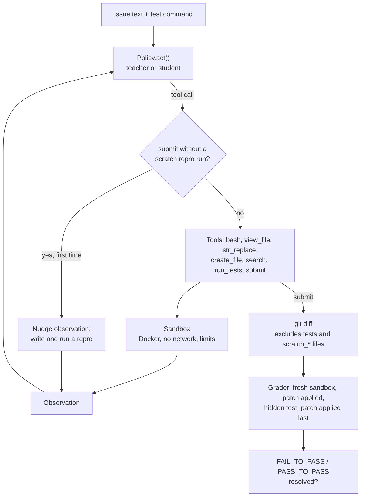
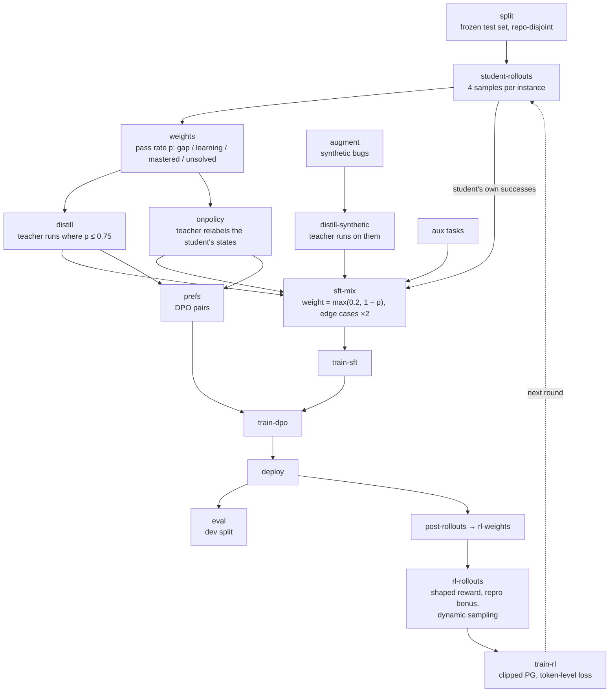

# repo-fix-agent

A bug-fixing agent you can plug onto any repository, plus the tooling to make a small, cheap
**student** model as good as a strong **teacher**: evaluation, data pipelines built on 10k engineer
demos, teacher distillation (off- and on-policy), preference learning, and RL.

| Doc | What's in it |
|---|---|
| [CHANGELOG.md](CHANGELOG.md) | every attempt so far: what was tried, what was measured, what is implemented but not yet run |
| [docs/DESIGN.md](docs/DESIGN.md) | problem setup, data schema, sandbox, grading |
| [docs/BASELINE.md](docs/BASELINE.md) | measured student vs teacher accuracy on the 100 seed demos and failure analysis |
| [docs/DEMO_DATA_PROPOSALS.md](docs/DEMO_DATA_PROPOSALS.md) | proposals for using the engineer demos, with implementation status |
| [configs/models.yaml](configs/models.yaml) | student / teacher candidates, student serving + scaffold options |

## Current status

| | Model | Seed set (100) |
|---|---|---|
| Teacher | `claude-opus-5-5` | **98%** resolved, 5.5 steps, about $0.04 per instance |
| Student | `nemotron-lightning-3p5-30b-a3b` (Fireworks, 30B MoE, ~3B active) | **88%** resolved, 24.0 steps (85% before the scaffold changes) |

Student failures are mostly fixes that cover only the issue's example and miss the rest of the
behaviour, not tool misuse (see BASELINE.md). The no-training scaffold is measured: the
repro-only submit gate took the student from 85% to 88% and cut partial fixes from 8 to 3. The
training steps in CHANGELOG "Unreleased" are implemented and tested offline but not yet run.
The seed set is close to its ceiling. Add harder instances before relying on small gains.

## Architecture

Three loops share one agent runtime:
- **Fix** (`fix`, `serve`): fix bugs in a real repository and open PRs.
- **Evaluate** (`eval`): measure a model on demos with hidden tests, record the run and update
  the dashboard.
- **Train** (`student-train`): turn teacher runs, student runs and engineer demos into training
  data for the student, then measure it again.



### One episode

Teacher and student run the same loop. The student's options (spec-check prompt, submit gate,
step budget, reasoning replay) come from `configs/models.yaml`. The same options are used
when rendering SFT data and in the RL environment, so training matches inference.



Every model call goes through the LLM cache (`llm_cache.py`). A repeated request replays the
recorded response, which is why a scaffold change can be measured as a paired comparison. The
hidden tests are applied only after the agent finishes, so it can neither see nor edit them.

### Training round

`repo-fix student-train` prints this plan with a cost per stage and runs one stage at a time.
Paid stages need `--yes`. Which distillation stages appear depends on what the teacher exposes
(`repo-fix distill-signal`): with Claude it uses reasoning relabels; a same-tokenizer teacher
adds the `token-distill` + `tokenkl` or `gkd` stages.



### Where things live

| Concern | Module |
|---|---|
| Agent loop, prompts, submit gate, optional steps-left notice | `agent.py` |
| Action space | `tools.py` |
| Sandboxes (Docker / local) and an episode's repo copy | `sandbox.py`, `env.py` |
| Teacher and student policies, serving config | `policies.py` |
| Grading with hidden tests | `grader.py` |
| Evaluation, run database, dashboard | `evaluation.py`, `rundb.py`, `dashboard.py` |
| Cost control | `llm_cache.py`, `envfile.py` |
| Data pipeline and training stages | `pipeline/` (one module per stage; see [Data pipeline](#data-pipeline-engineer-demos)) |
| RL environment and rewards | `pipeline/rl.py`, `pipeline/rl_rewards.py` |
| Distillation mode by teacher signal | `pipeline/teacher_signal.py`, `chat_spans.py` |
| Training (SFT, DPO, PG, tokenkl, GKD) | `scripts/train_lora.py` |
| Web UI: clone, environment, bugs, fixes, PRs | `web/` |

## Setup

```bash
pip install -e '.[teacher,openai]'      # optional extras: embed, voyage, secrets
cp .env.example .env                    # fill in ANTHROPIC_API_KEY, FIREWORKS_API_KEY (gitignored)
docker build -f docker/sandbox.Dockerfile -t repo-fix-sandbox:py3.12 docker   # the sandbox
python -m pytest -q                     # 451 tests, offline (no API calls)
```

* Keys load from `.env` automatically; variables already set in your shell win.
* **Sandbox:** the agent and the hidden tests run in Docker with no network. `--sandbox local`
  (before the subcommand) is for development only.
* **API cost control:**
  * Every LLM and embedding request is recorded with its response in `.cache/llm/` and replayed
    on reruns. Repeated *sampled* requests still get distinct answers the first time.
  * `repo-fix llm-cache stats` shows what was saved. Set `REPOFIX_LLM_CACHE=off` to resample.
  * Teacher calls use Anthropic prompt caching.
  * Paid pipeline stages refuse to run without `--yes`.

## Use the agent

```bash
repo-fix fix --repo ../some-repo --issue-file issue.md --test-cmd "python -m pytest -q" [--apply]
repo-fix serve        # web UI: paste a repo URL -> verified fixes -> one PR per fix
```

For `serve`:
1. **Clone:** it uses your `gh` login (or `GITHUB_TOKEN`).
2. **Environment:** it installs dependencies once, with network access, into a sandbox image.
3. **Find bugs:** it groups failing tests (and optionally issues labeled `bug`) into bugs.
4. **Fix and verify:** it fixes each bug in an offline container. A fix counts only if its tests
   now pass and nothing that passed before breaks.
5. **Open PRs:** it opens a PR per fix after you review it, or automatically for verified fixes.
   If your token can't push to the repo, it pushes to a fork.

The server listens on localhost only. Anyone who can reach it can push with your credentials.

## Evaluate

```bash
repo-fix validate data/demos/seed.jsonl                       # gold patches flip hidden tests (free)
repo-fix eval data/demos/seed.jsonl --model claude-opus-5-5 --workers 6 --label "teacher baseline"
repo-fix eval data/demos/seed.jsonl --model student --workers 8 --label "student baseline"
# noise-aware: mean pass@1 over 3 samples, plus pass@3 (the best-of-n ceiling)
repo-fix eval runs/splits/dev.jsonl --model student --samples 3 --temperature 0.7
# best-of-n with the execution reranker (reports chosen vs oracle accuracy)
repo-fix eval runs/splits/dev.jsonl --model student --best-of 4 --temperature 0.7
```

Results go to the run database (below). `--out file.jsonl` additionally writes per-instance JSONL
plus a `.summary.json`, and `--save-rollouts` writes episodes to a file. Both are optional: the
database already keeps the results, the summary and every episode (`repo-fix db export`).

**Run database.** Every `eval` is also recorded in `runs/repofix.sqlite` (`$REPOFIX_DB` to move
it, `--no-db` to skip). It stores:
- **The run:** model, scaffold settings and system-prompt hash, dataset hash, git commit, sampling
  settings, summary, usage and cost.
- **Results:** every sample's result.
- **Episodes:** every full episode (trajectory and patch), so `--save-rollouts` is optional.

```bash
repo-fix db runs                               # all runs, newest first
repo-fix db show latest                        # settings + accuracy by difficulty
repo-fix db compare "student baseline v1 (2026-11-22)" latest   # which instances flipped
repo-fix db export latest --what episodes --out runs/x/rollouts.jsonl   # pipeline input
repo-fix eval ... --resume <run>               # continue a crashed run; finished samples are skipped
repo-fix db import old.jsonl --label ...       # bring in results from before the database
```

**Backtest dashboard.** Every `eval` rewrites `runs/dashboard.html`: one self-contained page, no
external resources, light and dark themes. It shows:
- **Headline tiles:** latest accuracy and change vs the previous comparable run, steps, API calls, cost.
- **Charts:** accuracy across runs, accuracy by difficulty, and why the failures failed (gave up,
  ran out of steps, partial fix, broke a passing test, ...).
- **Lists:** the instances that flipped, and an instance × run matrix.
- **A table of every run.**

`repo-fix dashboard --run <id> --baseline <id> --open` builds one for any pair of runs.

## Improve the student

**Without training** (on by default for the student in `configs/models.yaml`):
- **`keep_reasoning`:** keeps the model's `reasoning_content` and sends it back each turn. Before
  this, it was dropped and the student rebuilt its plan every turn.
- **`spec_check`:** the system prompt asks it to list the behaviours and edge cases the issue
  implies and check them with `scratch_*.py` repro scripts, which never ship in the patch.
- **`submit_gate`:** one nudge if it submits without running a `scratch_*.py` repro script since
  its last edit. Running the existing tests doesn't count, because its failures pass them.
- **Step budget:** the student gets 50 steps (`max_steps` in `models.yaml`; teachers keep 40).
  A "[N steps left]" countdown (`step_notice`) is available but off, because baseline v4 showed no
  gain from it.
- **Best-of-n with the execution reranker:** pools every candidate's repro scripts, runs each
  patch against all of them and the test suite, and picks the best. Selection costs no model calls.

**With training**, one round:

```bash
repo-fix split data/demos/seed.jsonl --out-dir runs/splits      # frozen test split, repo-disjoint
repo-fix student-train --round r1                              # prints every stage + cost; runs nothing
repo-fix student-train --round r1 --run augment                # free stages run directly
repo-fix student-train --round r1 --run distill --yes          # paid stages need --yes
```

The stages, in order:
1. **`augment`:** synthetic bug-injected instances, tagged when their hidden tests go beyond the
   issue's example.
2. **`student-rollouts`:** 4 student episodes per instance, kept for the later stages.
3. **`weights`** (free): each instance's student pass rate p sets its bucket and training weight
   (see below).
4. **`distill`:** rejection-sampled teacher trajectories, recorded under the student's prompt. Only
   for instances with p ≤ 0.75.
5. **`onpolicy`:** the teacher relabels the states the student actually reached (DAgger), and
   also produces step-level DPO pairs. Also only for p ≤ 0.75.
6. **`aux`:** auxiliary training tasks.
7. **`prefs`:** preference pairs.
8. **`sft-mix`:** engineer, teacher, on-policy and the student's own successful runs, weighted by
   difficulty, with edge-case instances weighted 2x.
9. **`export`:** chat fine-tuning JSONL.
10. **`train-sft`, then `train-dpo`:** `scripts/train_lora.py`, on a GPU box.
11. **`deploy`:** Fireworks on-demand deployment.
12. **`eval`**
13. **`post-rollouts`, then `rl-weights`:** pass rates of the fine-tuned student, for the RL curriculum.
14. **`rl-rollouts`, then `train-rl`:** RL on instances the student solves only sometimes:
    - **Reward** (`--reward shaped`): 1 if resolved; otherwise 0.5 × the share of target tests
      passed. A penalty of 0.5 × the share of previously passing tests broken applies either way.
      +0.1 if one of the student's `scratch_*.py` scripts fails on the base commit and passes on its
      patch (checked by running it). Scoring uses only the hidden tests.
    - **Dynamic sampling** (`--dynamic-sampling`): a group whose rewards all tie gives no learning
      signal, so it's dropped and another instance is drawn.
    - **Update** (`train_lora.py --objective pg`): a clipped policy gradient. The ratio limit is
      looser upward (`--clip-low 0.2 --clip-high 0.28`), so rare good tokens can grow, and the loss
      is averaged per token (`--loss-agg token`), so long episodes aren't diluted. Two passes over
      each batch, plus a KL penalty to the reference.

**Difficulty weighting** (`repo-fix difficulty-weights`, no model calls). Training effort goes
where the student's pass rate p is low, not by which model solved an instance:

| Bucket | Student pass rate | Used for | SFT weight |
|---|---|---|---|
| gap | never (teacher solves or unknown) | teacher distillation, on-policy relabel | 1 − p (= 1) |
| learning | sometimes | RL (groups with both wins and losses), DPO pairs | 1 − p |
| mastered | always | a little replay so it isn't forgotten | 0.2 |
| unsolved | never, teacher fails too | skipped (no correct run to learn from) | 0 |

`sft-mix --instance-weights` applies the weights and caps the summed weight per instance at 3, so
an instance with many recorded runs can't dominate.

**Distillation depends on what the teacher exposes** (`repo-fix distill-signal` prints the
chosen mode and why; set in `configs/models.yaml` → `distillation_signal`):

| Mode | Teacher exposes | Student needs | Training |
|---|---|---|---|
| `action` | only its text and tool calls | - | SFT on the teacher's action at states the student reached, DPO where they disagree |
| `reasoning` | its reasoning text | - | the same, plus the reasoning as a target: in the student's `reasoning_content` if it has one, otherwise in `content`. Summarized reasoning gets weight 0.5, raw reasoning 1.0 |
| `topk` | per-token log-probs through an API | same tokenizer | `token-distill` has the teacher score the student's own tokens; `--objective tokenkl` (per-token reverse KL + top-k forward KL) |
| `logits` | full logits (weights on your GPU box) | same tokenizer | `--objective gkd --teacher-base ...` (full-distribution KL; `--gkd-beta` 1 = reverse, 0 = forward) |

Claude returns summarized thinking and no log-probs, so with the current config the mode is
`reasoning`. Token-level modes need a teacher from the student's model family (same token ids),
for example a larger same-family model on Fireworks. `student-train --signal` adds the matching stages.

**Training runs outside this repo.** Fireworks' managed SFT/DPO stopped taking new jobs on
2026-11-09. The exported JSONL fits their Training API, or use the bundled
`scripts/train_lora.py` (transformers + PEFT; SFT, DPO and policy-gradient objectives) on a GPU.
The current student supports supervised LoRA on Fireworks, but not RL and not serverless LoRA,
so a fine-tuned version needs an on-demand deployment.

## Data pipeline (engineer demos)

One command per proposal in `docs/DEMO_DATA_PROPOSALS.md`:

| Group | Commands |
|---|---|
| Clean and split | `audit` (validation, flakiness, dedup incl. semantic, leakage, secrets/PII), `split`, `eval-set` |
| Training data | `distill`, `mix`, `sft-mix`, `aux-tasks`, `prefs`, `augment`, `onpolicy-distill`, `difficulty-weights` |
| Verification and RL | `verifier-train`, `best-of-n`, `rl-rollouts` |
| Retrieval | `retrieval-index`, `retrieve` (hybrid TF-IDF + embeddings) |
| Training | `distill-signal`, `token-distill`, `export-chat-ft`, `fireworks-deploy`, `student-train` |

## Layout

```
src/repo_fix_agent/
  agent.py        agent loop, system prompt, AgentOptions (spec check, submit gate)
  tools.py        action space: bash, view_file, str_replace, create_file, search, find_files,
                  insert, undo_edit, run_tests, submit
  sandbox.py      DockerSandbox (no network, limits) / LocalSandbox (dev)
  env.py          episode = sandbox + tool state; patch excludes tests and scratch_* files
  policies.py     AnthropicPolicy (teacher, prompt caching), OpenAIPolicy, LocalModelPolicy
                  (student on any OpenAI-compatible server: Fireworks / vLLM / SGLang)
  grader.py       FAIL_TO_PASS / PASS_TO_PASS grading
  evaluation.py   eval: parallel, multi-sample, best-of-n, cost accounting, rollouts
  llm.py          single-turn TextLLM (Claude / GPT) for pipeline steps
  llm_cache.py    record/replay cache for paid calls
  rundb.py        run database (runs, results, episodes, instances) + `repo-fix db`
  dashboard.py    backtest dashboard (HTML) from the run database
  envfile.py      .env loader
  sft.py          demo -> chat SFT example
  chat_spans.py   chat-template rendering with per-token loss weights (pipeline + train_lora)
  pipeline/       audit split distill sft_data aux_tasks preferences verifier rl retrieval augment
                  repro embed parallel rerank onpolicy training difficulty teacher_signal
  web/            `repo-fix serve`: jobs, GitHub forge, HTTP server, static UI
scripts/
  build_seed_dataset.py, seed_specs/     the 100 seed instances
  train_lora.py                          LoRA training: sft, dpo, pg (GRPO), tokenkl, gkd
  eval_retrieval_paraphrase.py           retrieval backend comparison
docker/sandbox.Dockerfile                sandbox image
data/demos/seed.jsonl, data/repos/       100 validated demos + their repos
```
